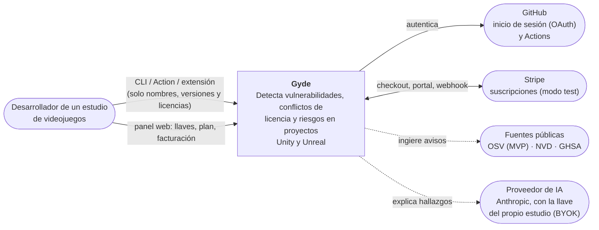
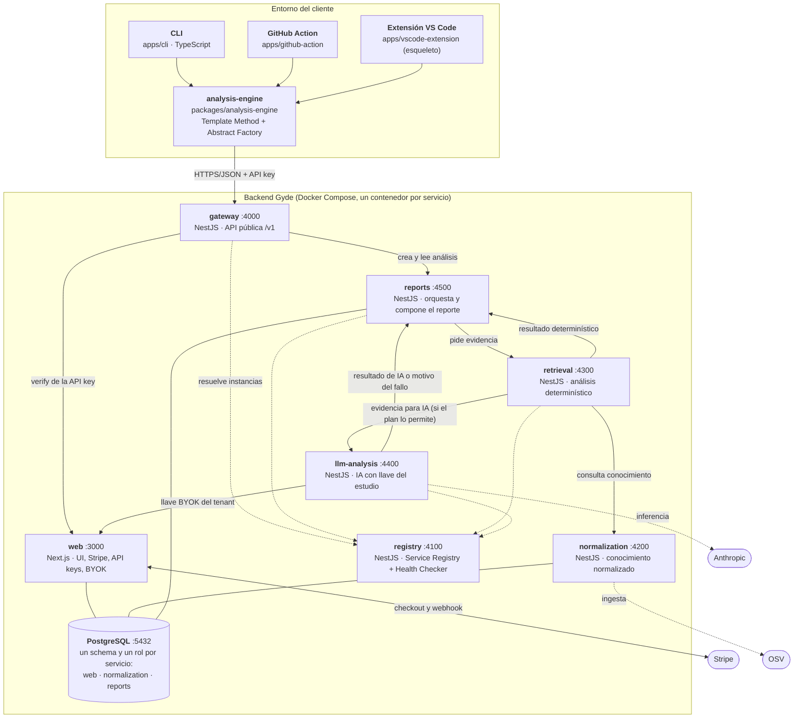
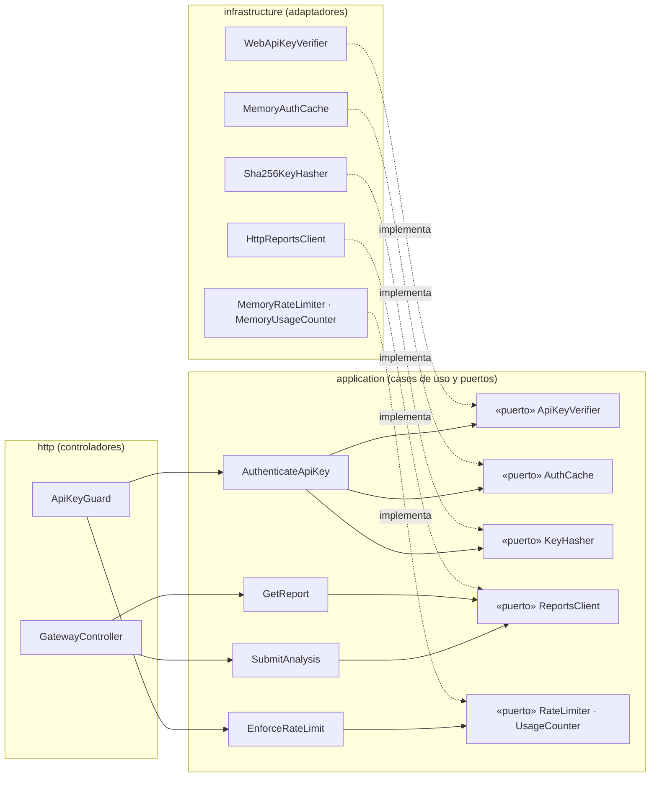
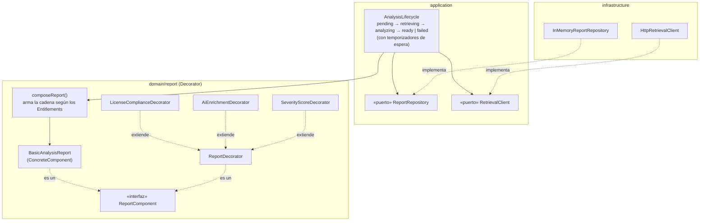
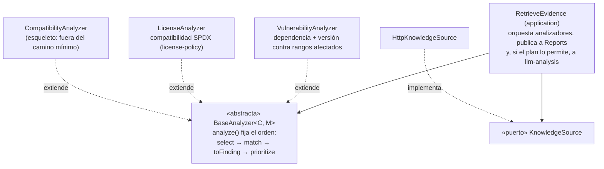
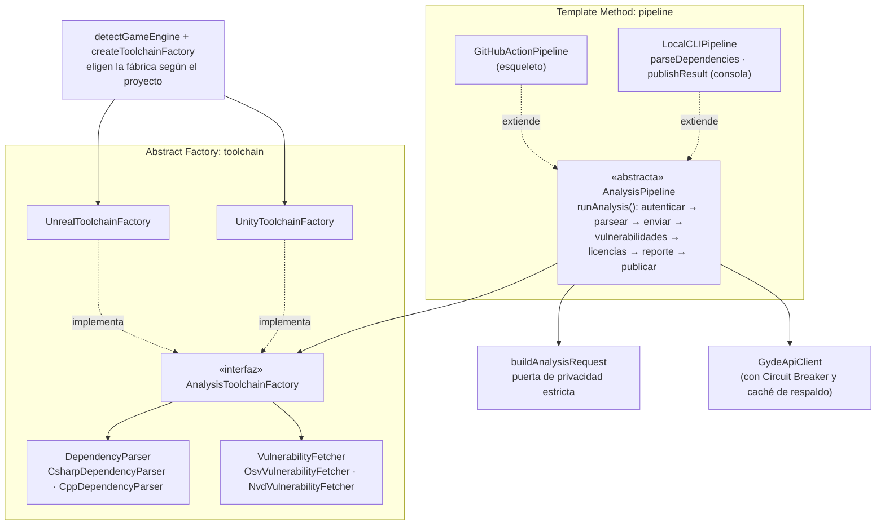
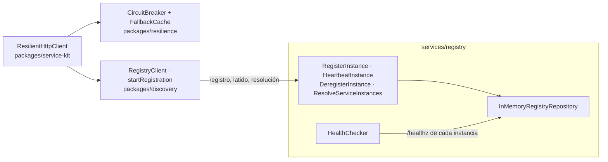

# Modelo C4

La arquitectura de Gyde en los tres primeros niveles del [modelo C4](https://c4model.com), más las vistas dinámicas (los flujos). Cada elemento nombra el **archivo del código** donde vive, para que el documento y el código se puedan contrastar. Convenciones: caja = elemento propio; óvalo = sistema o persona externos; flecha continua = llamada síncrona; punteada = relación externa o de infraestructura.

| Nivel | Responde | Dónde |
|---|---|---|
| 1. Contexto | ¿Quién usa Gyde y con qué sistemas habla? | Esta página |
| 2. Contenedores | ¿Qué procesos se despliegan y cómo se hablan? | Esta página y [01 Contenedores](01-contenedores.md) |
| 3. Componentes | ¿Cómo está hecho por dentro cada contenedor clave? | Esta página |
| Dinámico | ¿Qué pasa en el tiempo (feliz, degradado, fallo)? | [02 Flujos](02-flujos.md) |

## Nivel 1: contexto

Frontera de privacidad: el **código fuente del cliente nunca cruza** la flecha hacia Gyde ([04 Datos, privacidad y seguridad](04-datos-privacidad-seguridad.md)).

## Nivel 2: contenedores

Detalles que el diagrama resume:
- Las llamadas entre servicios usan `ResilientHttpClient` (`packages/service-kit`): **descubren la instancia en el registry** (con `*_URL` como respaldo de desarrollo) y van **detrás de un Circuit Breaker**.
- `/internal/*` exige `x-internal-token` y el gateway **nunca** lo enruta.
- Reports hoy guarda los análisis en memoria (`InMemoryReportRepository`); el adaptador PostgreSQL es el cambio de un solo adaptador gracias al puerto `ReportRepository`.

## Nivel 3: componentes

### gateway: Clean Architecture visible

Archivos en `services/gateway/src/{http,application,infrastructure}`. La caché de verify se indexa por **SHA-256 de la clave**, nunca por la clave. Los contadores del plan y de tasa están en memoria (se pierden al reiniciar): limitación asumida del MVP.

### reports: patrón Decorator

Cadena en tiempo de ejecución (`services/reports/src/domain/report/compose-report.ts`): `Basic → LicenseCompliance → AiEnrichment (solo si el plan lo incluye y llegó el resultado de IA) → SeverityScore` (siempre último). El plan `free` nunca lleva IA; con IA caída el reporte sale **degradado** pero con los mismos hallazgos.

### retrieval: patrón Template Method

`services/retrieval/src/domain/analyzers/`. Las subclases rellenan los pasos variables (`select`, `match`, `toFinding`); el esqueleto y la priorización están en la clase base.

### analysis-engine (cliente): Template Method y Abstract Factory

`packages/analysis-engine/src/{pipeline,toolchain,privacy,client}`. Una familia (Unity: C# + OSV) o la otra (Unreal: C++ + NVD) se elige según el proyecto; el pipeline solo conoce las interfaces.

### Transversal: Circuit Breaker y Service Discovery

Cada servicio se registra al arrancar (`startService`) y envía latidos; el Health Checker elimina instancias que no responden. Quien llama resuelve la instancia, pasa por el breaker (por dependencia; en llm-analysis, por **tenant + proveedor**) y, si no hay instancia sana, responde `503 upstream_unavailable` sin quedarse colgado.

## Coherencia con el código y alcance honesto

| Afirmación del documento | Evidencia |
|---|---|
| Cadena Decorator y plan `free` sin IA | `compose-report.ts`; ejecución real en [`docs/evidence/humo-2026-10-12.txt`](../evidence/humo-2026-10-12.txt) (capas `basic, license-compliance, ai-enrichment, severity-score`) |
| Degradado sin caída del análisis | Mismo archivo: caso 3, `degraded=true`, `llm-unavailable`, mismos hallazgos |
| Circuit Breaker + Discovery | Mismo archivo: con Reports detenido el gateway responde `503` y se recupera |
| `/internal/*` no se enruta | Mismo archivo: respuesta `404` |
| Layering impuesto | `tooling/eslint/layer-boundaries.mjs` (`pnpm lint` falla si `domain`/`application` importan infraestructura o NestJS) |

Fuera del MVP o en esqueleto, declarado: `CompatibilityAnalyzer`, `GitHubActionPipeline`, extensión de VS Code, fuentes NVD y GHSA, persistencia de Reports en PostgreSQL (hoy en memoria), contadores de plan y tasa persistentes.
