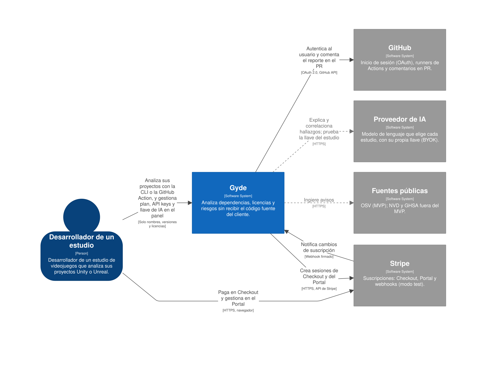
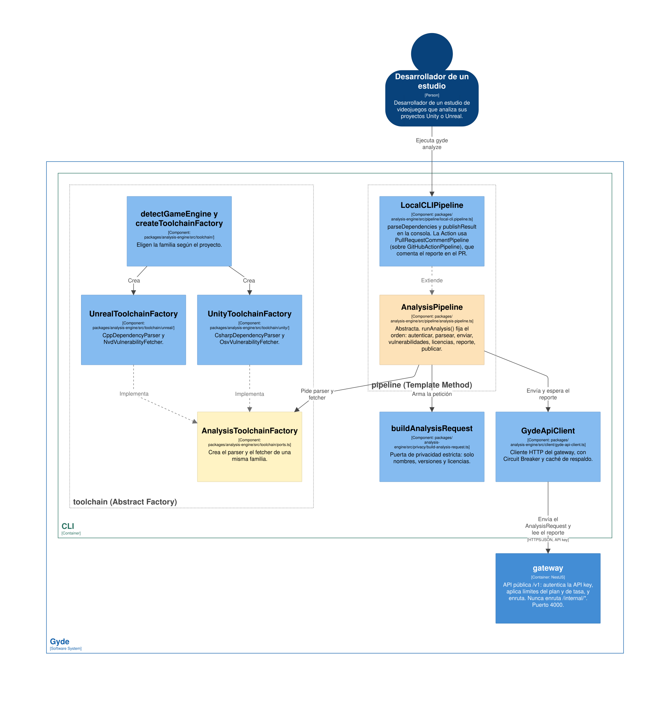
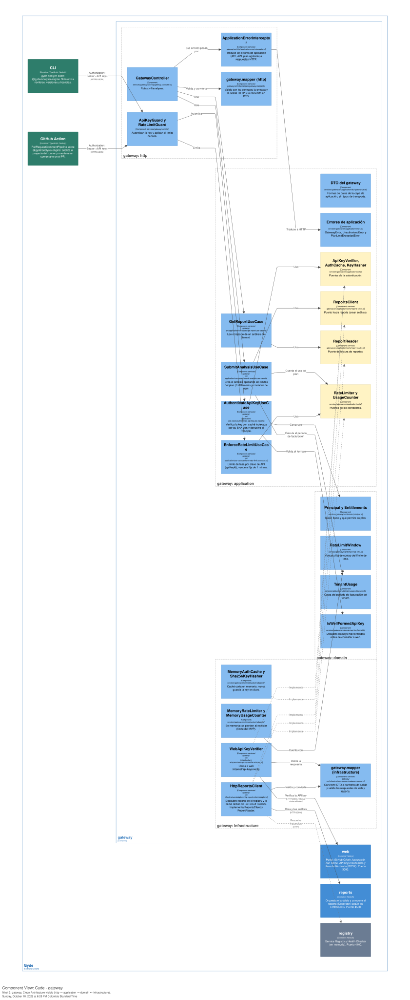
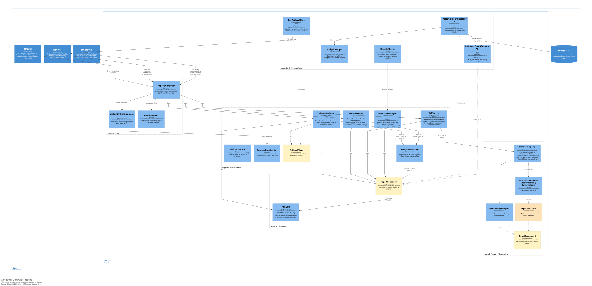
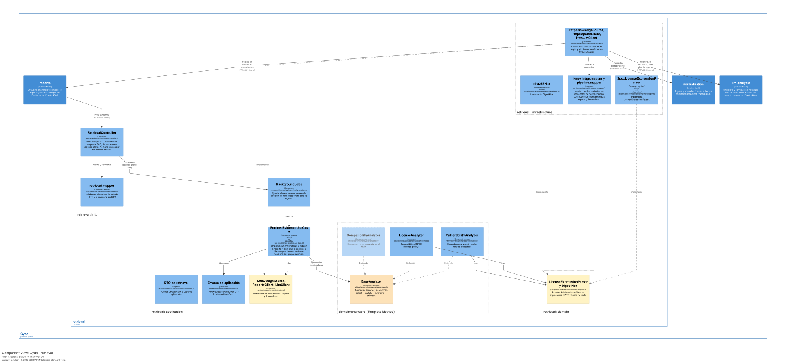
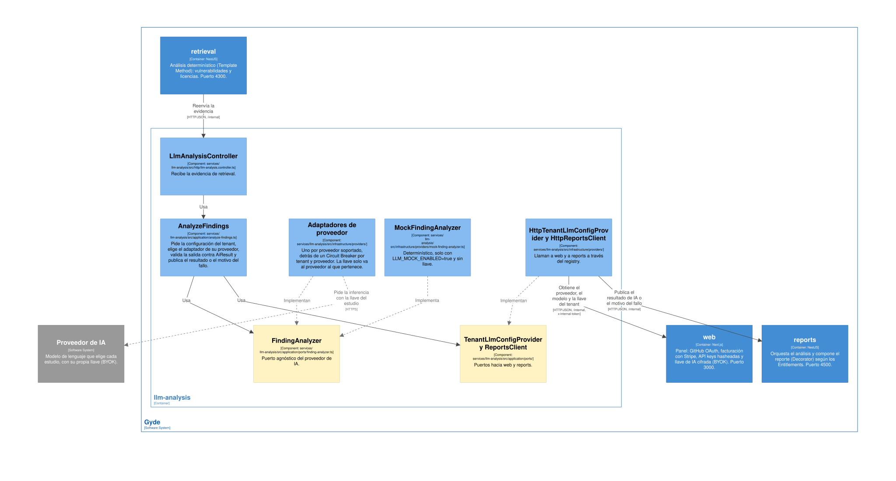
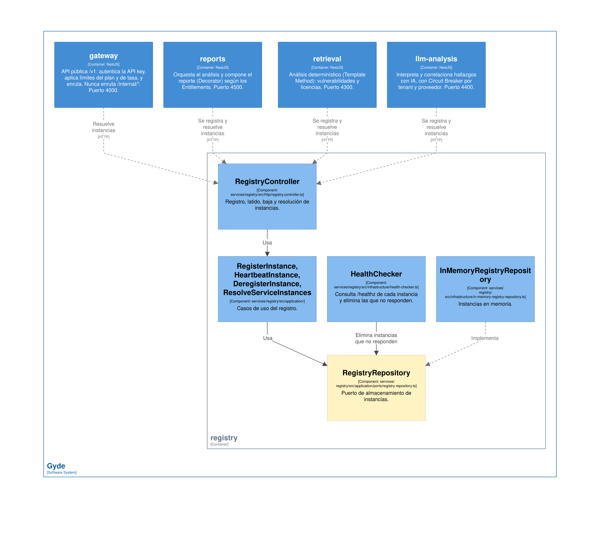

# Modelo C4

La arquitectura de Gyde en los tres primeros niveles del [modelo C4](https://c4model.com). **La única fuente es [`c4/workspace.dsl`](c4/workspace.dsl)** ([Structurizr DSL](https://docs.structurizr.com/dsl)), y las imágenes de esta página se exportan de ella. Ningún otro documento dibuja contexto, contenedores ni componentes: si algo cambia, se cambia el DSL y se vuelven a exportar las vistas ([cómo](#cómo-se-edita-y-se-exporta)).

Cada componente nombra el **archivo del código** donde vive, para que el modelo y el código se puedan contrastar. Convenciones: gris = sistema externo; verde = cliente (entorno del usuario); amarillo = puerto (interfaz); naranja = clase abstracta; borde punteado = esqueleto; flecha continua = llamada síncrona o uso; punteada = infraestructura (registry), ingesta o inferencia externas, o «implementa».

| Nivel | Responde | Vista |
|---|---|---|
| 1. Contexto | ¿Quién usa Gyde y con qué sistemas habla? | [Contexto](#nivel-1-contexto) |
| 2. Contenedores | ¿Qué procesos se despliegan y cómo se hablan? | [Contenedores](#nivel-2-contenedores) (detalle en [01 Contenedores](01-contenedores.md)) |
| 3. Componentes | ¿Cómo está hecho por dentro cada contenedor clave? | [CLI](#cli-y-analysis-engine-template-method-y-abstract-factory), [gateway](#gateway-clean-architecture-visible), [reports](#reports-decorator), [retrieval](#retrieval-template-method), [llm-analysis](#llm-analysis-agnóstico-del-proveedor), [registry](#registry-service-discovery-y-health-checker) |

Lo que pasa en el tiempo (análisis feliz, degradado, fallo, Stripe, BYOK) no es parte del modelo estático: está en [02 Flujos](02-flujos.md).

## Nivel 1: contexto



Frontera de privacidad: el **código fuente del cliente nunca cruza** hacia Gyde; solo viajan nombres, versiones y licencias ([04 Datos, privacidad y seguridad](04-datos-privacidad-seguridad.md)). El proveedor de IA es **el que elige cada estudio** con su propia llave (BYOK, [ADR 0007](../adr/0007-llaves-llm-por-estudio-byok.md)); el modelo no depende de cuál sea.

## Nivel 2: contenedores


Detalles que el diagrama resume:
- Los clientes son la **CLI** y la **GitHub Action**, ambos sobre `@gyde/analysis-engine` (una librería, no un contenedor: se ve por dentro en la vista de componentes de la CLI). Solo conocen la URL del gateway.
- Las llamadas entre servicios usan `ResilientHttpClient` (`packages/service-kit`): **descubren la instancia en el registry** (con `*_URL` como respaldo de desarrollo) y van **detrás de un Circuit Breaker**.
- `/internal/*` exige `x-internal-token` y el gateway **nunca** lo enruta.
- El Servicio Web habla con el proveedor de IA solo para **probar la llave** del estudio al guardarla, siempre con el probador de su propio proveedor; la inferencia la hace llm-analysis.
- Reports guarda los análisis en su schema de PostgreSQL (`PostgresReportRepository`, con migraciones propias y un barrido de arranque que cierra los análisis colgados). Sin `REPORTS_DATABASE_URL` usa `InMemoryReportRepository`: el composition root elige el adaptador y el puerto `ReportRepository` no cambia.

## Nivel 3: componentes

### CLI y analysis-engine: Template Method y Abstract Factory



`packages/analysis-engine/src/{pipeline,toolchain,privacy,client}`. Una familia (Unity: C# + OSV) o la otra (Unreal: C++ + NVD) se elige según el proyecto; el pipeline solo conoce las interfaces. La GitHub Action usa el mismo motor con `PullRequestCommentPipeline` (`apps/github-action`, sobre `GitHubActionPipeline`), cuyo `publishResult` comenta el reporte en el PR.

### gateway: Clean Architecture visible



Archivos en `services/gateway/src/{http,application,infrastructure}`. La caché de verify se indexa por **SHA-256 de la clave**, nunca por la clave. Los contadores del plan y de tasa están en memoria (se pierden al reiniciar): limitación asumida del MVP.

### reports: Decorator



Cadena en tiempo de ejecución (`services/reports/src/domain/report/compose-report.ts`): `Basic → LicenseCompliance → AiEnrichment (solo si el plan lo incluye y llegó el resultado de IA) → SeverityScore` (siempre último). El plan `free` nunca lleva IA; con IA caída el reporte sale **degradado** pero con los mismos hallazgos.

### retrieval: Template Method



`services/retrieval/src/domain/analyzers/`. Las subclases rellenan los pasos variables (`select`, `match`, `toFinding`); el esqueleto y la priorización están en la clase base. `CompatibilityAnalyzer` es un esqueleto: no se instancia en el MVP.

### llm-analysis: agnóstico del proveedor



`AnalyzeFindings` solo conoce el puerto `FindingAnalyzer`. Cada proveedor soportado es **un adaptador** en `services/llm-analysis/src/infrastructure/providers/`: añadir uno no toca el caso de uso ni el dominio. La llave del tenant solo se entrega al proveedor al que pertenece, y cada tenant + proveedor tiene su propio Circuit Breaker. Qué proveedores hay hoy: [`services/llm-analysis/README.md`](../../services/llm-analysis/README.md).

### registry: Service Discovery y Health Checker



Cada servicio se registra al arrancar (`startService`, `packages/discovery`) y envía latidos; el Health Checker elimina instancias que no responden. Quien llama resuelve la instancia, pasa por el breaker (`packages/resilience`; por dependencia y, en llm-analysis, por **tenant + proveedor**) y, si no hay instancia sana, responde `503 upstream_unavailable` sin quedarse colgado.

## Cómo se edita y se exporta

1. Edita [`c4/workspace.dsl`](c4/workspace.dsl) y valídalo:
   ```bash
   docker run --rm -v "$PWD/docs/architecture/c4:/w" structurizr/structurizr validate -w /w/workspace.dsl
   ```
   Sin salida es que está bien; un error indica la línea.
2. Ábrelo en Structurizr local. El contenedor escribe en su carpeta de datos, así que usa una copia:
   ```bash
   mkdir -p /tmp/gyde-c4 && cp docs/architecture/c4/workspace.dsl /tmp/gyde-c4/ && chmod -R a+rwX /tmp/gyde-c4
   docker run --rm -p 127.0.0.1:8080:8080 -v /tmp/gyde-c4:/usr/local/structurizr structurizr/structurizr local
   ```
   y abre `http://127.0.0.1:8080/workspace/1/diagrams`.
3. Exporta cada vista a SVG desde esa página y reemplaza el archivo del mismo nombre en `docs/architecture/c4/` (el nombre es la clave de la vista: `Contexto`, `Contenedores`, `Componentes-<contenedor>`). La imagen Docker no exporta PNG/SVG desde la línea de comandos ([documentación](https://docs.structurizr.com/export/png-and-svg)), por eso se exporta desde el navegador.
4. Commitea el DSL y los SVG juntos, en el mismo PR.

## Coherencia con el código y alcance honesto

| Afirmación del modelo | Evidencia |
|---|---|
| Cadena Decorator y plan `free` sin IA | `compose-report.ts`; ejecución real en [`docs/evidence/humo-2026-10-12.txt`](../evidence/humo-2026-10-12.txt) (capas `basic, license-compliance, ai-enrichment, severity-score`) |
| Degradado sin caída del análisis | Mismo archivo: caso 3, `degraded=true`, `llm-unavailable`, mismos hallazgos |
| Circuit Breaker + Discovery | Mismo archivo: con Reports detenido el gateway responde `503` y se recupera |
| `/internal/*` no se enruta | Mismo archivo: respuesta `404` |
| Layering impuesto | `tooling/eslint/layer-boundaries.mjs` (`pnpm lint` falla si `domain`/`application` importan infraestructura o NestJS) |
| Cada componente existe | El tipo o la ruta de cada caja del DSL está en el código de `dev` |

Fuera del MVP o en esqueleto, declarado: `CompatibilityAnalyzer`, fuentes NVD y GHSA, contadores de plan y tasa persistentes. La GitHub Action está implementada y probada con un gateway falso, pero no se demuestra en vivo contra un gateway local.
